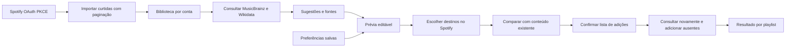

# Pipeline do MVP

## Fluxo implementado

1. **Entrada:** todas as páginas de curtidas são carregadas antes de alterar a biblioteca local. Faixas removidas da biblioteca ficam inativas; suas correções continuam armazenadas.
2. **Identidade:** ID/URI Spotify é a chave da faixa por conta. ISRC, quando presente, auxilia a consulta externa. Título e artista são usados como alternativa conservadora. Candidatos ambíguos não são escolhidos automaticamente.
3. **Enriquecimento:** consulta incremental com cache e intervalo. Gêneros e idiomas podem continuar vazios. A faixa permanece disponível para edição manual. Não há IA.
4. **Sugestão:** considera as categorias escolhidas. Uma preferência salva substitui os destinos sugeridos para aquela faixa. Exclusão do projeto tem prioridade. Gênero, idioma e destino são armazenados separadamente.
5. **Prévia:** usuário pode corrigir cada campo, marcar vários destinos ou deixar fora. Falta de gênero não impede um destino manual. Faixas sem destino ficam fora do conjunto a adicionar.
6. **Plano de gravação:** usuário seleciona playlists existentes próprias ou criação privada. O plano contém IDs, URIs, faixas e diferenças em relação ao Spotify. Alterações posteriores invalidam a prévia. Confirmação é única e expira.
7. **Execução:** serializada no processo local, somente adições, lotes de até 100. Consulta novamente antes de gravar; guarda IDs das playlists. Interrompe em falha e exige nova prévia para reconciliar.

## Persistência

| Informação | Chave / local |
|---|---|
| Biblioteca e revisão | Conta Spotify + ID da faixa, SQLite |
| Categorias | Conta Spotify, SQLite |
| Playlists gerenciadas | Conta Spotify + nome da categoria, SQLite |
| Cache público | Hash da URL da fonte, SQLite, validade de sete dias |
| Tokens OAuth | Memória da sessão |
| Plano confirmado | Memória da sessão, validade de dez minutos |

O piloto local e as contas Spotify são separados. Importar a revisão pessoal exige ação explícita. As oito categorias atuais são a configuração inicial editável.

## Fora desta entrega

Hospedagem pública, abertura a usuários não autorizados pelo Spotify, remoções automáticas, análise de áudio e IA. O projeto inclui a base de isolamento por conta, mas a implantação multiusuário requer infraestrutura e revisão de permissões antes de publicação.
